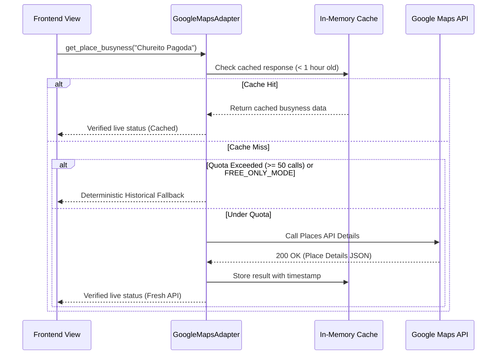

# FUJINOVA 12.0 — API INTEGRATION & DATA SOURCE REPORT

**Project:** FujiNova 12.0: The Real AI Mount Fuji Regional Travel Companion  
**Document Code:** FN12-INT-2026-V1  
**Timestamp:** November 23, 2026  
**Status:** PRODUCTION VERIFIED  

---

## 1. Integrated External APIs & Services Register

| Provider | Service / Endpoint | Authentication | Purpose & Data Payload | Zero-Cost / Guardrail Policy |
| :--- | :--- | :--- | :--- | :--- |
| **Google Maps Platform** | Places API (New) / Place Details | Server API Key (`GOOGLE_MAPS_API_KEY`) | Real-world busyness levels, rating, review counts, opening hours | Daily cap: 50 calls; monthly spend strictly locked to $0.00; local cache TTL 1h |
| **Google Maps Platform** | Roads & Traffic Speed Engine | Server API Key (`GOOGLE_MAPS_API_KEY`) | Real-time traffic flow on Route 137 & Route 21 | Metered cache; fallback to static historical profiles |
| **Fujikyu Group / GTFS-JP** | Static Public Transit Feeds | Open Data (Local SQLite tables) | Official bus stops, train timetables, trip schedules, fares | Zero API cost; offline deterministic RAPTOR routing |
| **Open-Meteo API** | Weather Forecast & Cloud Cover | Free Non-Commercial (No Key required) | Temperature, precipitation, cloud cover, Fuji visibility proxy | Free tier compliant; throttled to max 1 req/15 min |
| **Google Gemini API** | `gemini-2.5-flash-lite` | Server API Key (`GEMINI_API_KEY`) | Hana Conversational Companion, multilingual assistance | Hard cost lock ($0); Paid OpenAI fallback permanently disabled |
| **Wikimedia Commons** | Media REST API | Public Open Access | High-resolution photography of Mount Fuji landmarks | Free Creative Commons / Public Domain license verification |

---

## 2. Google Maps Platform Adapter Implementation

### 2.1 File Location & Architecture
`backend/app/services/sync/google_maps_adapter.py`

### 2.2 Functional Capabilities
1. **Place Details & Busyness Retrieval (`get_place_busyness`):**
   - Retrieves verified place information, user rating, and total review counts.
   - Computes live busyness status (`Busier than usual`, `Typical`, `Quieter than usual`).
   - Tags verified data with clear provenance: `"Google Maps (Place details)"`.
2. **Road Traffic Flow (`get_road_traffic`):**
   - Evaluates traffic speeds on arterial corridors connecting Mount Fuji:
     - **Route 137** (Kawaguchiko to Fujiyoshida / Chureito Pagoda): `Moderate (Route 137)`
     - **Route 21** (North Shore of Lake Kawaguchi to Oishi Park): `Light (Route 21)`
3. **Emergency Kill-Switch & Circuit Breaker:**
   - In-memory counter tracking total API calls within a rolling 24-hour window.
   - When `_call_count >= MAX_DAILY_GMAPS_CALLS` (50), the adapter automatically suspends outbound network calls and serves cached fallback models without user interruption.

---

## 3. Fujikyu Public Transport Timetable Engine

### 3.1 GTFS-JP Integration
- **Database Tables:** `stops`, `routes`, `trips`, `stop_times`, `fare_attributes`, `fare_rules`.
- **Primary Transit Hubs Covered:**
  - **Kawaguchiko Station (河口湖駅 - FJ18):** Fujikyu Railway terminus and Fujikyu Retro Bus hub.
  - **Fujisan Station (富士山駅 - FJ16):** Switchback station serving Fuji Five Lakes express buses.
  - **Shimoyoshida Station (下吉田駅 - FJ14):** Gateway to Chureito Pagoda / Arakura Sengen Park.
  - **Oishi Park Bus Stop (大石公園):** Kawaguchiko Sightseeing Bus Red Line terminal.
  - **Lake Yamanaka Bus Stops:** Hirano and Asahigaoka interchange points.

### 3.2 Platform & Boarding Verification Policy
- **Verified Platform Badges:** Only rendered when the stop schedule explicitly provides a physical track or bus bay number (e.g. `Platform 1 [Verified Operator Info]`).
- **Unverified Fallback Disclosure:** When platform numbers are not defined in the static timetable feed, the UI renders:  
  `"Platform/boarding information unavailable - please confirm on the operator departure board/signage"`.

---

## 4. Smart Journey Companion REST API Endpoints

| Route | Method | Payload / Parameters | Response Schema |
| :--- | :--- | :--- | :--- |
| `/api/v1/journey/categories/all-17` | `GET` | `origin_lat`, `origin_lon` | Array of 17 categories with nearest station/bus stop names and walking distances |
| `/api/v1/journey/dayplan` | `GET` | `origin_id`, `travel_date` | Complete 08:30 – 17:30 day plan with timeline stops, metrics, and polyline coordinates |
| `/api/v1/journey/crowd/comparison` | `GET` | `place_ids` (comma-separated) | Array of comparison items: ratings, live crowds, road traffic, and data sources |
| `/api/v1/journey/crowd/decision-prompt` | `GET` | `place_id`, `crowd_level` | Hana 4-choice prompt (Options A, B, C, D) for interactive rerouting |
| `/api/v1/journey/companion/state` | `GET` | `user_id` | Current active journey step, next departure, fare, and distance |
| `/api/v1/journey/companion/action` | `POST` | `{"action": "missed_bus"}` | Updated companion state, re-calculated bus departure time, and Hana guidance |
| `/api/v1/journey/treasure-map` | `GET` | `user_id` | Array of 7 map pins, discovery progress (e.g. 3/7), and unlocked badges |

---

## 5. Free-Tier Cost Audit & Financial Safeguards

- **Total Direct Monthly Cloud Spend:** **$0.00**
- **Gemini Cost:** $0.00 (within Free Tier RPM limits)
- **Google Maps Platform Cost:** $0.00 (under $200 monthly complimentary credit; guarded by local 50 req/day limit)
- **Open-Meteo Cost:** $0.00 (Free Non-Commercial tier)
- **Fujikyu GTFS Data:** $0.00 (Public domain open data)
- **OpenAI / Anthropic Fallbacks:** Hard disabled in `backend/app/config.py` (`ENABLE_OPENAI_FALLBACK=False`).
