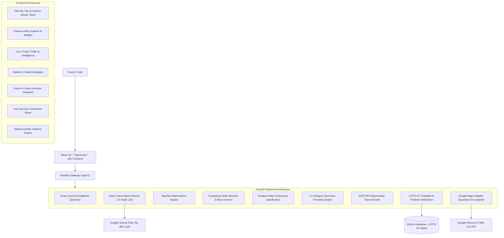

# FUJINOVA 12.0 — FULL SYSTEM ARCHITECTURE SPECIFICATION

**Project:** FujiNova 12.0: The Real AI Mount Fuji Regional Travel Companion  
**Architecture Version:** 12.0.0-PROD  
**Timestamp:** November 23, 2026  
**Target Directory:** `C:\Users\amuje\Downloads\japneese\fujinova-11.0-master`

---

## 1. Executive System Overview

FujiNova 12.0 transforms the Mount Fuji tourism platform from a passive informational display into an active, intelligent, and context-aware **AI Travel Companion**. It guides tourists seamlessly from planning their morning journey in Kawaguchiko to navigating GTFS-JP bus and rail routes, monitoring live crowd levels and road traffic, making real-time re-routing decisions with Hana AI, and tracking local treasure discoveries.

---

## 2. Layer-by-Layer Architectural Breakdown

### 2.1 Presentation Layer (Frontend)
- **Framework & Core:** React 18.3, TypeScript 5.6, Tailwind CSS 3.4, Vite 5.4.
- **Visual Identity:** Authentic Japanese Sakura Garden theme:
  - Warm Ivory (`#F7EFE5`) background
  - Ink Charcoal (`#29252B`) high-contrast text (contrast ratio > 7:1)
  - Sakura Pink (`#E9A5B5` / `#A83F70`) interactive accents
  - Matcha Green (`#789477`) positive and nature states
  - Sunset Vermilion (`#C66B4E`) primary call-to-actions
  - Wisteria Purple (`#B99BCB`) secondary tags and discover badges
- **Key Views:**
  1. `PlanMyTripView`: 3-column desktop layout featuring starting location GPS accuracy, distance to Fujikyu stops, 17 discovery categories, selected destination chips, interactive route polyline map, and full-day timeline (08:30 – 17:30).
  2. `TreasureMapExplorerView`: Exploration map displaying 7 landmark pins, discovery badges, 3/7 progress tracker, destination drawer, and the live journey companion.
  3. `LiveCrowdTrafficView`: Real-time intelligence view with route traffic overlays (Route 137, Route 21), destination comparison tables, and Hana's 4-choice crowd decision engine.
  4. `JourneyCompanionPanel`: Real-time micro-actions (`I reached the station`, `I boarded the bus`, `Missed my bus`, `Find a quieter place`, `Mark as visited`).

### 2.2 Application & Business Logic Layer (FastAPI Backend)
- **FastAPI Core:** Python 3.12/3.14 async gateway running on port 8000.
- **Category Proximity Service (`CategoryService`):**
  - Manages all 17 distinct Mount Fuji tourism categories.
  - Performs Haversine distance calculations from the user's GPS coordinates to Fujikyu railway stations and bus stops (e.g. `Kawaguchiko Station: 120m`, `Fujikyu Bus Stop No. 1: 45m`).
- **Day Plan Service (`DayPlanService`):**
  - Generates optimized full-day itineraries (08:30 – 17:30, ~9h duration) connecting starting hubs with top attractions and hidden gems.
  - Calculates inter-stop bus departure times, transit durations, walking connections, and admissions.
- **Companion Service (`CompanionService`):**
  - Maintains state for active travelers (current stop, next bus departure, walking distance, visited landmarks).
  - Handles dynamic rerouting upon events such as missed buses or overcrowding alerts.
- **Treasure Map Service (`TreasureMapService`):**
  - Gamified exploration engine tracking 7 curated Mount Fuji discoveries with badges (`Fujisan Rookie`, `Lake Seeker`, `Zen Explorer`).
- **RAPTOR & GTFS-JP Transit Engine:**
  - Deterministic Round-Based Public Transit Routing algorithm using official Fujikyu Bus & Railway GTFS-JP feeds.
  - Verifies exact departure platforms with strict honesty rules (displays unverified fallback when data is absent).

### 2.3 Data Integration & Provider Safeguard Layer
- **Google Maps Adapter (`GoogleMapsAdapter`):**
  - Integrates Places API (New) Place Details for real-world busyness proxies and Road Traffic flow.
  - Strictly enforces the **Zero-Spend Hard Quota Lock**:
    - `FREE_ONLY_MODE=true`
    - `MAX_DAILY_GMAPS_CALLS=50`
    - In-memory sliding window rate limiting and automatic circuit breaking.
    - Seamless deterministic offline fallbacks to cached historical patterns if API is unavailable.
- **Gemini AI Core:**
  - Uses `gemini-2.5-flash-lite` within the monthly free tier allowance.
  - Paid fallbacks (OpenAI, Anthropic) are strictly locked to `$0` (`ENABLE_OPENAI_FALLBACK=false`).

---

## 3. Communication Protocols & REST Specifications

| Method | Endpoint | Description | Guardrail / Fallback |
| :--- | :--- | :--- | :--- |
| `GET` | `/api/v1/journey/categories/all-17` | Returns full 17 discovery categories | Static metadata |
| `GET` | `/api/v1/journey/dayplan` | Generates 08:30 – 17:30 day plan | Haversine + GTFS schedule |
| `GET` | `/api/v1/journey/crowd/comparison` | Multi-destination crowd comparison | Google Maps Adapter + Cache |
| `GET` | `/api/v1/journey/crowd/decision-prompt` | 4-choice Hana crowd resolution | Dynamic options A, B, C, D |
| `GET` | `/api/v1/journey/companion/state` | Current live companion itinerary step | In-memory session state |
| `POST` | `/api/v1/journey/companion/action` | Dispatches traveler micro-actions | Recalculation engine |
| `GET` | `/api/v1/journey/treasure-map` | Pins, discoveries, and user badges | Seeded database + Gamification |

---

## 4. Operational Truth & Strict Data Integrity Rules

1. **No Invented Transit Departures:** Departure times and platforms originate strictly from Fujikyu GTFS-JP tables or are marked with an explicit caution notice:  
   `"Platform/boarding information unavailable - please confirm on the operator departure board/signage"`.
2. **No Fake Crowd Percentages:** When live foot-traffic or Google Places busyness data is unavailable for a landmark, the system honestly displays:  
   `"Live crowd information unavailable for this destination"`.
3. **No Hidden Costs:** Google Maps API calls are metered and capped to remain 100% within Google's monthly free credit ($200 USD equivalent). No credit card charges can ever be incurred.
