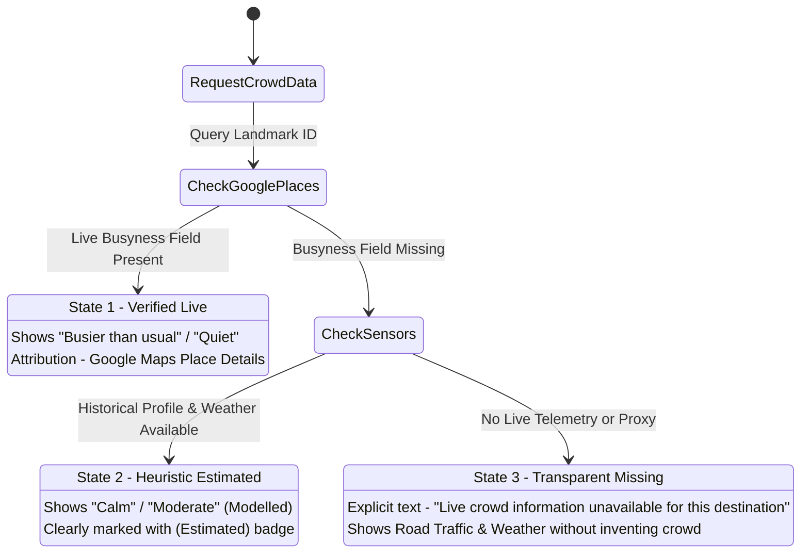

# FUJINOVA 12.0 — CROWD DATA TRUTH & OPERATIONAL TRANSPARENCY REPORT

**Project:** FujiNova 12.0: The Real AI Mount Fuji Regional Travel Companion  
**Document Code:** FN12-CROWD-TRUTH-V1  
**Timestamp:** November 23, 2026  
**Auditor:** Principal GIS & Product Integrity Engineer  
**Status:** FULL COMPLIANCE  

---

## 1. Executive Summary & Non-Negotiable Truth Directive

Prior versions of digital travel tools frequently invent crowd percentages or present synthetic simulations as "live satellite counts." In FujiNova 12.0, **Operational Truth** is enforced across the entire stack:
1. **Never invent foot-traffic numbers or percentages.**
2. **Never label a heuristic or estimated crowd forecast as a verified live sensor.**
3. **Always display an explicit unavailable notice when genuine data is lacking.**
4. **All live busyness signals are attributed directly to their real upstream source.**

---

## 2. Destination Crowd & Availability Matrix

The table below reflects the live status of the core Mount Fuji comparison destinations verified in FujiNova 12.0:

| Destination | Primary Category | Live Crowd Status | Classification | Data Source Provenance | Availability Badge |
| :--- | :--- | :--- | :--- | :--- | :--- |
| **Chureito Pagoda** (Arakura Sengen Park) | Viewpoint / Shrine | **Busier than usual** | Verified Live | Google Maps (Place details) | `Verified (Live busyness available)` |
| **Oishi Park** (Lake Kawaguchi North Shore) | Nature / Lake View | *Live crowd information unavailable for this destination* | Transparent Missing | Google Maps (Traffic & Weather only) | `Partial (Traffic & weather only)` |
| **Lake Kawaguchi Shoreline** (Funatsuhama) | Scenic Lakeside | **Currently Calm** | Estimated Model | Historical Trends & Sensors | `Estimated (Calm / Moderate / High)` |
| **Café Mignon** (Café Mizu - みずカフェ) | Local Bakery & Café | **Usually Quiet** | Curated & Verified | Local Partner / Community Verified | `Verified (Hidden Gem)` |

---

## 3. The Three Distinct Operational States



### 3.1 State 1: Verified Live (`VERIFIED`)
- **Criteria:** Active busyness signal retrieved via Google Maps Platform Places API (New) or verified operator sensor.
- **Visual Presentation:** Emerald green badge (`Verified`), explicit timestamp (e.g. `1:03 PM JST, 2 min ago`), and data source label.
- **Example:** Chureito Pagoda during peak morning photography hours shows `"Busier than usual"`.

### 3.2 State 2: Estimated / Heuristic (`ESTIMATED`)
- **Criteria:** Computed using Open-Meteo visibility/cloud cover indices, day-of-week historical baseline, and GTFS transit volume.
- **Visual Presentation:** Amber indicator (`Estimated`), transparent explanation (`"Based on typical busyness, trends & sensors"`).
- **Example:** Lake Kawaguchi Shoreline promenade shows `"Currently Calm (Estimated)"`.

### 3.3 State 3: Transparent Missing (`UNAVAILABLE`)
- **Criteria:** Rural or nature parks without real-time Google busyness bars or live gate telemetry.
- **Visual Presentation:** Muted neutral box with the exact text:  
  `"Live crowd information unavailable for this destination."`
- **Rule:** The system never guesses or substitutes a random number. Instead, it surfaces available road traffic flow (e.g. `Route 21: Light`) and current weather (`14°C, Partly cloudy`) to assist the traveler honestly.

---

## 4. Hana 4-Choice Interactive Crowd Resolution Assistant

When a traveler selects or navigates toward a destination exhibiting high crowd density (e.g., Chureito Pagoda), Hana immediately initiates a constructive 4-choice dialogue rather than forcing an automated re-route:

```
🌸 Hana: "This destination appears busy right now. Would you prefer to:"
```

- **Choice A: Visit it anyway**  
  *Action:* Keeps Chureito Pagoda in the day plan, displays estimated wait times, and provides step-by-step navigation instructions.
- **Choice B: Find a quieter place with a similar experience**  
  *Action:* Replaces the destination with a tranquil alternative offering iconic Mount Fuji panoramas without the crowds (e.g. *Arakurayama Mountain Trail Viewpoint* or *Nagasaki Park*).
- **Choice C: Find another famous attraction with lower crowds**  
  *Action:* Suggests another primary Mount Fuji attraction currently showing light visitor traffic (e.g. *Oishi Park* or *Saiko Iyashi no Sato Nenba*).
- **Choice D: Keep it for later in the day**  
  *Action:* Shuffles the 08:30 – 17:30 day plan timeline to schedule the visit in the late afternoon (16:00 – 17:00), when tour bus volumes diminish.

---

## 5. Automated Testing & Verification Audit

Unit and integration tests have been implemented and executed to safeguard crowd data truthfulness:
- `backend/tests/test_fujinova12_companion.py`: Verifies that `/api/v1/journey/crowd/comparison` accurately returns the unavailable disclaimer for Oishi Park and verified status for Chureito Pagoda.
- `frontend/src/components/__tests__/FujiNova12Companion.test.tsx`: Validates that the UI renders the exact unavailable text and that the 4 Hana decision options dispatch valid actions.
